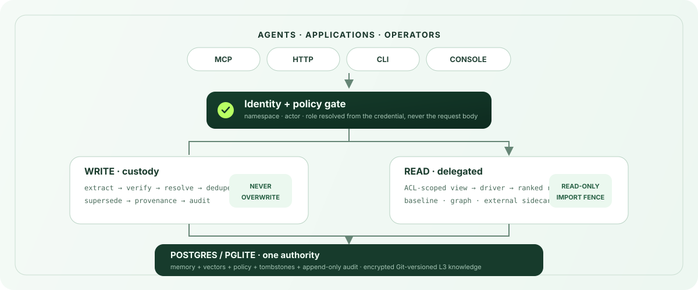

<h1 align="center">Halofy</h1>

<p align="center">
  <strong>An open organizational-memory kernel for AI agent fleets.</strong><br />
  Custody, access control, provenance, audit, and signed erasure. Retrieval is delegated to swappable read-only drivers.
</p>

<p align="center">
  <a href="#quickstart"></a>
  <a href="docs/architecture.md"></a>
  <a href="docs/driver-kit.md"></a>
  <a href="https://github.com/halofyai/halofy/discussions"></a>
</p>

<p align="center">
  <a href="https://github.com/halofyai/halofy/actions/workflows/ci.yml"></a>
  <a href="LICENSE"></a>
  <a href="kernel/package.json"></a>
  
  
</p>

---

An agent fleet needs more than similarity search. It needs answers to harder
questions: **who may read this fact, where did it come from, what happened when
it contradicted an older fact, and can deletion be proven?** Halofy is the layer
that answers those questions.

It owns the memory lifecycle and keeps retrieval replaceable. The result is a
kernel you can inspect, self-host, run offline, and connect over MCP or HTTP.

## Why Halofy

| Custody | Governance | Open retrieval |
|---|---|---|
| Writes follow one auditable path: extract → verify → dedupe → supersede → provenance. Facts are never silently overwritten. | Identity is resolved from credentials, ACLs are enforced in the repository layer, every syscall audits, and erasure produces an offline-verifiable certificate. | Drivers receive an ACL-scoped, read-only view and return ranked references. A six-check conformance kit enforces the boundary. |

### What ships in this repository

- **Memory syscalls over MCP and HTTP:** `mem_write`, `mem_read`, `mem_search`,
  `mem_assemble`, `mem_fault`, `mem_stats`, `mem_forget`, policy, sharing,
  pinning, export, and manifest operations.
- **A bi-temporal custody write path:** provenance, entity resolution, exact and
  semantic dedupe, supersedence chains, and append-only audit.
- **Two storage tiers:** Postgres/pgvector for operational memory and encrypted,
  Git-versioned knowledge for the cold tier. Embedded PGlite is the zero-setup
  local default.
- **A frameworkless control room:** memory, sources, policies, conflicts,
  retrieval quality, teams, audit, alerts, skills, connected apps, and export.
- **Four public connectors:** filesystem, Postgres, Obsidian, and manual CSV
  import. All feed the same governed write path.
- **A hermetic test lane:** embedded PGlite, deterministic `StubLlm`,
  `HashEmbedder`, and zero network access.

## Quickstart

### Run the complete offline story

```bash
git clone https://github.com/halofyai/halofy.git
cd halofy/kernel
npm ci
npm run demo
```

No API key. No database server. No model download. No network call. The demo
boots the real kernel on embedded PGlite, then exercises pinning, assembly,
writes, hybrid search, an L3 context fault, audit, import, fragmentation, and
signed erasure.

```text
== T0 ·· boot in-memory, pin the refund policy, assemble the working set
booted: embedder=hash(dim=256) llm=stub

== T3 ·· mem_fault - page missing context in from L3
fault: hit=true source=L3 injected=2

== T7 ·· mem.forget - erase the customer and mint a signed certificate
certificate 01... verifyCertificate === true
after forget: mem_search surfaces 0 matching facts

demo complete - kernel closed.
```

Then prove the kernel and its retrieval boundary:

```bash
npm test
npx tsx src/cli.ts conformance baseline
```

The current standalone verification passes **2,675 tests across 204 files** and
all **6/6** driver-conformance checks. Timings and generated identifiers vary by
machine; the behavior does not.

### Start the API and control room

```bash
cd kernel
npm run serve
```

Open [`http://localhost:8787/console/login`](http://localhost:8787/console/login).
For a durable self-hosted deployment with Postgres, generated keys, and Docker
Compose, follow [the self-hosting guide](docs/self-hosting.md).

### Connect an agent over MCP

```bash
cd kernel
npx tsx src/cli.ts keygen org/support/agent-1 user:dana owner
HALOMEM_API_KEY=hm_... npm run mcp
```

The API key resolves the namespace, actor, and role server-side. MCP tool
schemas do not accept caller-asserted identity fields.

## Architecture

<p align="center">
  
</p>

### The important boundaries

1. **Identity is server-owned.** Namespace, actor, role, and source scope come
   from the credential, never from a request body.
2. **Writes have custody.** Corrections close the prior fact's validity interval
   and link the replacement. They do not overwrite history.
3. **Reads are delegated.** A retriever sees only an ACL-scoped `ScopedView` and
   can return references only. It cannot write or reach audit/storage modules.
4. **Postgres is the authority.** Memory, embeddings, policy, provenance,
   tombstones, and audit live together. PGlite embeds the same model for local
   development and tests.
5. **Every outcome audits.** Success, denial, miss, brownout, and error paths all
   append an event.

Read [the architecture guide](docs/architecture.md) for the syscall pipeline,
ACL examples, SQL, tiering, brownout behavior, and a per-directory source map.

## Security model

The core namespace rule is deliberately small: a caller in namespace `N` sees
rows belonging to `N` or an exact `/`-split ancestor of `N`. Siblings and
descendants remain invisible unless an explicit, audited administration path
allows a subtree operation.

```text
caller: org/support/agent-1

org                          visible     ancestor
org/support                  visible     ancestor
org/support/agent-1          visible     self
org/support/agent-2          hidden      sibling
org/support/agent-1/scratch  hidden      descendant
org/sales                    hidden      sibling
```

The query layer enforces this rule with exact ancestor matching. Retrieval
drivers do not reimplement it; they receive an already-scoped view. See the
[threat model](docs/security/threat-model.md) for the known partial controls and
adversarial cases, and the [architecture guide](docs/architecture.md) for the
worked ACL queries.

## Open by design

The standalone build is not a trial:

| Property | Standalone behavior |
|---|---|
| Licence/activation | No licence key, edition flag, activation, or entitlement check |
| Packaging quota | None; the public `QuotaPort` defaults to `UNMETERED` |
| Capacity controls | Operator-owned policy rate limits and model-budget brownout only |
| Telemetry | None; no usage beacon or Halofy phone-home |
| Models | Offline deterministic defaults; optional direct Anthropic, OpenAI-compatible, OpenAI embedding, and Azure OpenAI configuration |
| Database | Embedded PGlite by default; regular Postgres/pgvector for durable deployments |
| Export | Open schema, export, manifest, and erasure paths |

The permanent boundary is documented in
[OPEN-SOURCE-SCOPE.md](OPEN-SOURCE-SCOPE.md). The practical feature matrix is in
[open build vs. managed service](docs/commercial/open-vs-managed.md).

### Deliberately commercial

Halofy's managed operations, not memory custody, fund the open kernel:

- model routing, spend attribution, and gateway observability;
- billing, credit ledger, and hosted usage plans;
- operated Slack, Discord, WhatsApp, and Google Chat applications;
- the managed SaaS connector catalogue and its OAuth applications;
- federated live query across organizations;
- the tuned extraction prompt pack; and
- managed infrastructure, upgrades, backups, uptime, and support commitments.

None of those components is required to run this repository. The connector
framework, baseline model plumbing, memory lifecycle, governance, console,
self-host stack, and test suite are present and runnable.

## Documentation

| Guide | Use it when you want to… |
|---|---|
| [Getting started](docs/getting-started.md) | Go from clone to first key, write, search, MCP connection, and real model configuration |
| [Architecture](docs/architecture.md) | Trace requests, understand custody, or change the kernel |
| [Driver kit](docs/driver-kit.md) | Build and validate a retrieval cartridge |
| [Self-hosting](docs/self-hosting.md) | Run Postgres, Docker Compose, backups, restores, and upgrades |
| [Threat model](docs/security/threat-model.md) | Review assets, boundaries, adversaries, and known partial controls |
| [Open-source scope](OPEN-SOURCE-SCOPE.md) | See what stays open and how that promise changes |
| [Kernel reference](kernel/README.md) | Find scripts, source directories, environment variables, and development commands |

The full index is in [docs/README.md](docs/README.md).

## Contributing

Start with [CONTRIBUTING.md](CONTRIBUTING.md). Security-sensitive changes to
authentication, tenancy, ACLs, migrations, encryption, audit, erasure, or the
write/retrieval boundary require adversarial review and regression coverage.

Security reports belong in the private channels described by
[SECURITY.md](SECURITY.md), not in public issues. Community expectations are in
[CODE_OF_CONDUCT.md](CODE_OF_CONDUCT.md).

## License

The kernel and console are **AGPL-3.0-or-later**. Named client and extension
subtrees are **Apache-2.0** so they can be embedded without relicensing the
host application. These include `kernel/src/driver/`, `kernel/src/mcp/`, and
`kernel/integrations/`. See [LICENSING.md](LICENSING.md) and [NOTICE](NOTICE)
for the authoritative file-by-file boundary.

The Halofy name is a trademark; neither software licence grants trademark
rights. See [TRADEMARK.md](TRADEMARK.md).
