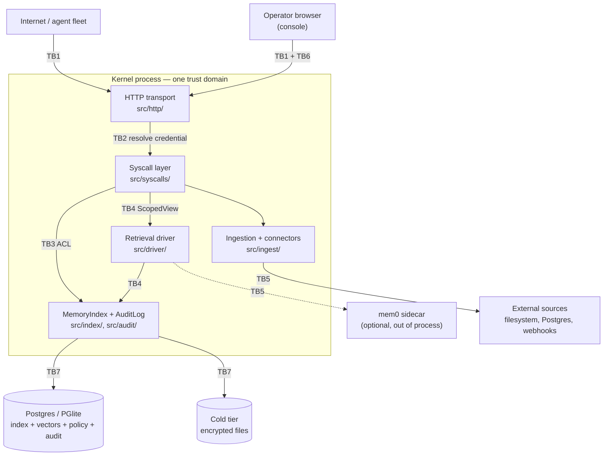

# Halofy threat model

**Status:** living document. Revise it when a boundary moves, not when a release ships.
**Scope:** the open-source kernel and console in this repository — `kernel/src/`,
`kernel/console/`, `kernel/deploy/`, and the container image built from
`kernel/Dockerfile`. The Halofy-managed gateway, managed channels, and the managed
connector catalog are separate systems and are not modelled here.
**Companion:** [`../../SECURITY.md`](../../SECURITY.md) for how to report what you find.

---

## 0. Why this document exists in this shape

Halofy's product claim is *custody* — that it can say who read which sentence,
when, under what policy, and prove it later. A checklist ("we validate input, we
use parameterized queries") does not test that claim. What tests it is naming the
people who want to break it and following each of their moves through this
specific architecture until it hits something that stops them.

So the structure is: assets → boundaries → adversaries → per-adversary attack
paths with the control that stops each → an explicit list of the controls that
are only partial. Section 6 is the section worth reading first if you are here to
find a bug.

Every control below cites a file that was read while writing this. Where a
control is partial, the word **Partial** appears and the residual risk is stated.
Nothing is described as mitigated because it is "handled somewhere".

---

## 1. Assets

Ranked by what an attacker gains, not by how much code protects them.

| # | Asset | Where it lives | Why it is worth attacking |
|---|---|---|---|
| AS1 | **Memory content** — extracted facts, verbatim writes, entities, concepts, pointers | `memory_objects`, `concepts`, cold-tier files | The organization's private knowledge. One cross-tenant read is a company-ending disclosure for a customer. |
| AS2 | **The audit trail** | `audit_log`, `audit_chain_state` | The evidence. An attacker who can suppress a row erases the fact that they were ever there; a customer who can forge one manufactures compliance. |
| AS3 | **Identity credentials** | `api_keys.key_hash`, `sessions.id`, bearer envelopes | A stolen key is a legitimate caller. Nothing downstream can tell the difference. |
| AS4 | **The erasure signing key** | `HALOMEM_SIGNING_KEY` (process env) | Whoever holds it can mint a `DeletionCertificate` for an erasure that never happened. |
| AS5 | **At-rest KEKs** | `HALOMEM_COLD_KEK`, `HALOMEM_SOURCE_CONFIG_KEK` | Decrypt cold-tier knowledge and every stored connector credential in one step. |
| AS6 | **Connector credentials** | `sources.config_ciphertext` | Lateral movement out of Halofy into the customer's Postgres, filesystem, and SaaS estate. |
| AS7 | **Policy and governance state** | `policies`, policy documents, tenant caps | Rewriting policy is a quieter way to widen access than attacking the ACL. |
| AS8 | **Deletion certificates and tombstones** | `deletion_certificates`, `tombstones` | The proof that a regulator-facing erasure occurred. |
| AS9 | **Metadata** — namespace names, actor identifiers, row counts, query strings | Everywhere, including `audit_log.purpose` | Leaks a customer's org chart, their vendors, and what they are working on, without leaking a single fact. |
| AS10 | **Embeddings** | `memory_objects` vector column | Inversion is imperfect but non-zero. Treat a vector as ciphertext with a short key, not as anonymised data. |
| AS11 | **Availability of the write path** | The process | Memory that cannot be written is memory that is silently lost. This is why brownout exists. |

---

## 2. Trust boundaries



| ID | Boundary | Crossing mechanism | Enforced in |
|---|---|---|---|
| **TB1** | Network → transport | HTTP request | `kernel/src/http/server.ts` |
| **TB2** | Credential → `Identity` | `Authorization: Bearer hm_…` or the session cookie | `kernel/src/auth/index.ts`, `kernel/src/console/auth.ts` |
| **TB3** | Caller namespace → stored rows | Every SQL predicate in the repository layer | `kernel/src/index/index.ts`, `kernel/src/audit/index.ts` |
| **TB4** | Kernel → retrieval driver | The `ScopedView` handed to `plan()` | `kernel/src/driver/view.ts`, `kernel/src/conformance/index.ts` |
| **TB5** | Kernel → external source | Connector reads, live queries, sidecar HTTP, webhook ingress | `kernel/src/ingest/`, `kernel/src/driver/mem0.ts` |
| **TB6** | Browser → console DOM | String-rendered HTML | `kernel/console/app.js` (`esc()`) |
| **TB7** | Process → storage | SQL and filesystem | `kernel/src/db/`, `kernel/src/security/postgres.ts`, `kernel/src/cold/index.ts` |
| **TB8** | Operator → process | Environment variables, volumes, container | `kernel/src/config.ts` |

**Everything inside `PROC` is one trust domain.** That is the single most important
sentence in this document. An in-process retrieval driver, a connector, and the
syscall layer share a heap and a database handle. TB4's `ScopedView` is an
*architectural* fence enforced by a static scan, not a *runtime* sandbox. See §6.1.

TB8 is one-way: the operator is trusted. Halofy does not defend against the person
who controls the process, and does not pretend to.

---

## 3. Adversaries

| ID | Adversary | What they start with | What they want |
|---|---|---|---|
| **A1** | **Malicious tenant** | A legitimate API key or console login for their *own* namespace, in a multi-tenant deployment | Any row belonging to another tenant — or just confirmation that a competitor is a customer |
| **A2** | **Compromised agent** | A valid `agent` key, and full control of what text it sends | Escalate a memory-write credential into a read credential; poison what other agents will be told |
| **A3** | **Curious insider** | A valid human console account at a *lower* role — `member` or `auditor` — inside the org | Read a teammate's, a sub-team's, or the parent org's memory their role should not reach; act without leaving a trace |
| **A4** | **Malicious retrieval driver** | A cartridge the operator installed, running in-process | Read outside the `ScopedView`, write, or suppress audit |
| **A5** | **Network attacker** | Traffic interception, or an unauthenticated position in front of the API | Credentials, content in flight, replayed writes |
| **A6** | **Malicious content author** | The ability to get text into the system through ingestion or a shared channel — no credential at all | Prompt-inject the extraction LLM; plant content that XSSes the console operator; poison retrieval |

The operator (A7) is deliberately absent: they are inside TB8.

---

## 4. Attack paths and controls

### A1 — Malicious tenant

The primary adversary. Tenants are root namespaces in one database; isolation is
the ACL, not a separate mechanism (`kernel/src/tenancy/index.ts` says this
explicitly, and it is worth internalising: there is no second fence to fall back
on if the first one leaks).

| Attack | Control | Where |
|---|---|---|
| Query a sibling tenant's rows through `mem_search`, `mem_read`, `mem_fault`, `assemble`, or `stats` | Every read builds its predicate from `namespaceAncestors(callerNamespace)` — an exact, parameterized `namespace IN (...)`. A sibling root is not an ancestor of anything the caller holds, so it is not in the list. | `kernel/src/index/index.ts` |
| Register a namespace crafted to abuse SQL pattern matching — `acme%`, `acme_`, `acme\` | The base ACL uses `IN (...)`, never `LIKE`, so metacharacters are inert. The places that genuinely need a subtree predicate use `escapeLikePattern(prefix) + "/%"` with `ESCAPE '\'` (`readScopeSql`). This class of bug has been shipped here twice; `kernel/test/cross-tenant.test.ts` now attacks it by name. | `kernel/src/index/index.ts`, `kernel/src/db/client.ts` |
| Assert a foreign namespace in the request body | Syscalls do not accept a namespace or actor at all (D9); they take a resolved `Identity`. Management routes that legitimately *name* a target namespace — policy, scorecard, policy-document upload, pins, fragmentation, mount forking, key issuance — each pass it through `assertAdminScope()`, which requires `owner`/`admin` **and** `isSelfOrDescendant(ns, identity.namespace)`, or `assertReadScope()` for reads. See §6.9. | `kernel/src/syscalls/index.ts`, `kernel/src/http/adapter.ts` |
| Probe for the existence of foreign rows by id, distinguishing "forbidden" from "absent" | `getById` returns `{ obj: null, denied: true }` internally so the audit can record `denied` distinctly, but `MemReadResult.denied` is hard-coded `false` on the caller-facing result. To the caller, forbidden and absent are the same answer. | `kernel/src/index/index.ts`, `kernel/src/syscalls/index.ts` |
| Read another tenant's audit trail | `auditSearchClauses()` opens with `namespace IN (...)` from a caller-supplied *visible* list, and every other filter is exact equality on a bound parameter. The comment in that file states the invariant: never a LIKE-wildcard, because a stored namespace with `_`/`%` would otherwise act as one. | `kernel/src/audit/index.ts` |
| Erase upward — call `mem_forget` against a parent or sibling namespace | Target resolution runs **downward** and is constrained to the caller's own subtree; an ancestor or sibling target resolves to zero rows and mints a certificate for nothing. | `kernel/src/erasure/index.ts` |
| Escape into a foreign namespace by mounting or sharing | Mounts and company-published grants are additive exceptions evaluated inside the same query-layer predicate (`readScopeAllows`, `companyPublishedSql`, `sourceAccessAllows`), not bypasses layered outside it. | `kernel/src/index/index.ts` |
| Exhaust a shared deployment to degrade a competitor | Per-key token bucket and per-namespace budget caps; over-cap writes brown out to verbatim rather than failing. **Partial** — see §6.5. | `kernel/src/policy/limits.ts`, `kernel/src/syscalls/index.ts` |
| Reach the raw tables through a hosted Postgres' REST layer | **Partial.** `ENABLE ROW LEVEL SECURITY` is a standing convention for tables added in the later half of the schema's history — 63 of the 136 tables in `src/db/migrations.ts` carry it. Owner and `service_role` bypass RLS, so the kernel is unaffected. The older core tables, `memory_objects`, `audit_log`, `api_keys` and `sessions` among them, do **not** have RLS enabled. See §6.10. | `kernel/src/db/migrations.ts` |

**Residual.** Namespace *names* are not secret in the way row contents are. A
tenant that can guess or enumerate namespace strings learns organizational
structure even when every read is denied — the denial is recorded, not
obfuscated. Treat namespace naming as semi-public.

---

### A2 — Compromised agent

An agent key is the most widely distributed credential in the system: it lives in
CI, on laptops, and inside other people's agent frameworks. Assume some are leaked.

| Attack | Control | Where |
|---|---|---|
| Use a `member`/`agent` key to perform admin operations | Every syscall opens with `gate()` — credential-still-active check, tenant gate, policy fetch, rate limit — and the role check runs immediately after it, before the operation body: `mem_write` denies `auditor`, `mem_forget` is owner/admin only. Admin operations are gated in the transport/admin layer, not in the syscall. Every denial appends an audit row via `auditDenied()`. | `kernel/src/syscalls/index.ts`, `kernel/src/http/adapter.ts` |
| Use a read-only agent badge to write | `requireAgentWrite()` denies when `identity.agentCanWrite === false`, and audits the denial with `detail: "read-only agent may not change memory"` before throwing. | `kernel/src/kernel.ts` |
| Keep using a key after revocation or expiry | Resolution reads `status` and `expires_at` from `api_keys` on every request; there is no in-memory identity cache to go stale. | `kernel/src/auth/index.ts` |
| Escalate by minting a key for a higher role or a foreign namespace | Key issuance is an admin operation, subtree-scoped by `assertAdminScope`. The bootstrap path — issuing the first key against an empty `api_keys` table — exists once and closes as soon as a row exists. | `kernel/src/auth/index.ts`, `kernel/src/http/adapter.ts` |
| Widen its own access by editing policy | Policy writes require `owner`/`admin` and pass `assertAdminScope`. A policy is never read from the request that uses it. | `kernel/src/http/adapter.ts`, `kernel/src/policy/store.ts` |
| Write facts that quietly override an existing fact | Conflicting facts do not overwrite. `closeValidity()` closes the prior validity window and the new row links back via `supersedes`, so the original remains queryable and the substitution is visible in the chain (D7). | `kernel/src/index/index.ts` |
| Operate without leaving evidence | D4: every syscall writes at least one row per logical outcome, including denied, miss, brownout and error. There is no `update` or `delete` method on `AuditLog`. | `kernel/src/audit/index.ts`, `kernel/src/syscalls/index.ts` |
| Exfiltrate secrets stored as memories into an agent's context | `classificationAllowsRead()` admits only `public`/`internal` content, or content whose `allowedDestinations` includes `agent-context`. It parses with a `restricted` default, so a malformed or missing classification fails **closed**. | `kernel/src/index/index.ts` |
| Read back a connector credential it caused to be stored | Connector config is returned as `REDACTED_SOURCE_CONFIG` — a frozen empty object that discloses neither field names nor values. The plaintext exists only inside the seal/open pair. | `kernel/src/ingest/source-config.ts` |

**Residual.** A leaked agent key gives full legitimate access to that agent's
namespace and its ancestors. Nothing in the kernel detects "this key is now being
used by someone else" — there is no device binding, no IP pinning, and no anomaly
detection. Key expiry (`expires_at`) is optional and defaults to standing access.
Short-lived keys are an operator discipline, not an enforced one.

---

### A3 — Curious insider

The adversary most likely to actually exist, and the one the ACL's *direction*
matters most for. Note the asymmetry, because it is a common source of confusion
and of bugs:

- **Memory reads climb.** Namespace `acme/eng/alice` sees `acme/eng/alice`,
  `acme/eng`, and `acme`. Shared org knowledge flows down to everyone.
- **Management descends.** `assertAdminScope` / `assertReadScope` admit only
  `isSelfOrDescendant(target, identity.namespace)`. An admin of `acme/eng`
  manages `acme/eng/*` and nothing above it.

These are different rules with different directions on purpose. A change that
"unifies" them will open a hole.

| Attack | Control | Where |
|---|---|---|
| Read a sub-team's or a peer's private memory | Descendants and siblings are not ancestors, so they are absent from the `IN (...)` list. A parent-namespace member does **not** inherit downward. | `kernel/src/index/index.ts` |
| Use a management route to reach a namespace outside their scope | `assertAdminScope` (mutations, owner/admin only) and `assertReadScope` (reads, any role) both require self-or-descendant; only a root owner is exempt. | `kernel/src/http/adapter.ts` |
| Read teammates' activity through analytics screens | `isOversightRole()` — owner, admin, auditor. Everyone else is pinned to their own `identity.actor` on the reporting read models. The namespace predicate still applies; the pin only narrows further. | `kernel/src/auth/index.ts` |
| Steal a colleague's console session | Session tokens are `randomBytes(32)` hex; `sessions.id` stores only their sha256, so a database dump yields no live cookie. Cookies are `HttpOnly; SameSite=Lax; Path=/`, `Secure` behind TLS, with a server-side `Max-Age` and server-enforced expiry. A disabled user cannot resolve a session — the JOIN filters on status. | `kernel/src/console/auth.ts`, `kernel/src/http/console.ts` |
| Brute-force or enumerate accounts at the login form | scrypt with a 16-byte per-user salt; `timingSafeEqual` comparison; an unknown email is compared against a module-load decoy hash so the work and the response shape are identical either way. | `kernel/src/console/auth.ts` |
| Delete their tracks after acting | `mem_forget` is explicitly forbidden from touching `audit_log`, and the syscall layer appends the `forget` row itself. Direct database tampering is detected by `verifyChain()`, which recomputes every `prev_hash`/`event_hash` link and names the first broken sequence number. | `kernel/src/erasure/index.ts`, `kernel/src/audit/index.ts` |
| Extract everything through export instead of search | Export is restricted to `owner`/`admin`/`auditor` (`member` and `agent` are denied), runs through the same ACL-scoped repository reads plus a DLP destination check, and is render-then-check: the audit row carries the sha256 of the rendered markdown as egress evidence. A **denied** export writes an audit row too. The audit summary counts exports separately from deletions. | `kernel/src/export/index.ts`, `kernel/src/audit/index.ts` |

**Residual.** The chain proves tampering *happened*; it does not restore what was
removed, and someone with `UPDATE` on the database can rewrite rows and
`audit_chain_state` together and produce a chain that verifies. Shipping
`audit_log` to append-only storage the kernel's database user cannot write is the
control that closes this, and it is the operator's to install. See §6.2.

---

### A4 — Malicious retrieval driver

Retrieval is delegated by design (D1). Drivers are "read-only cartridges" whose
whole world is meant to be the `ScopedView`.

| Attack | Control | Where |
|---|---|---|
| Import storage, the write path, or the audit log | `checkReadOnlySource()` statically scans driver source and rejects any quoted literal reaching `../{index,kernel,db,write,audit,cold}`. It matches barrel and facade forms (`../index.js`, `../kernel.js`) because those re-export the full storage surface. `npx tsx src/cli.ts conformance <driver>` runs it as one of six checks. | `kernel/src/conformance/index.ts` |
| Obfuscate the import — `req("../db/client.js")`, `import("../d" + "b/client.js")`, a template specifier | Every quoted or backtick literal is scanned regardless of surrounding syntax; `createRequire` is banned outright; any dynamic `import()`/`require()` whose specifier is not a single plain string literal is rejected conservatively. | `kernel/src/conformance/index.ts` |
| Read outside the caller's namespace through the view | `buildScopedView()` is the only constructor of a `ScopedView`. It implements no ACL of its own — it delegates every method to index calls already scoped by `namespaceAncestors`, and documents that assumption at the top of the file. | `kernel/src/driver/view.ts` |
| Return refs for rows the caller may not see | For the out-of-process mem0 sidecar, the response is whitelisted against the candidate set that was sent: any ref the sidecar returns that was not sent is dropped and warn-logged. The sidecar can only reorder. | `kernel/src/driver/mem0.ts` |
| Take retrieval down to force a degraded lane | `planViaDriver()` catches `DriverUnavailableError` from any non-baseline driver, falls back to `baseline` over the **same** view, and reports `driver_fallback=<name>->baseline` into the audit detail. The fallback never widens the view. | `kernel/src/syscalls/index.ts` |
| Exceed the token budget to blow up a downstream context window | Conformance's `budget-discipline` check asserts `sum(tokenEstimate) <= tokenBudget` across planted queries. | `kernel/src/conformance/index.ts` |

**Residual — and this one is real.** See §6.1. The in-process boundary is a
static scan of source text, not a runtime sandbox, and `ScoredRef` carries a
`content` field that `memSearch` returns to the caller without re-hydrating it
from the index. A hostile in-process driver can therefore fabricate content. It
is contained for the sidecar (ref whitelist) and unenforced for in-process
cartridges.

---

### A5 — Network attacker

| Attack | Control | Where |
|---|---|---|
| Read credentials or content off the wire | Out of the kernel's hands for its own listener — terminate TLS in front of it. Where the kernel is the client, it enforces transport security itself: `assertSecurePostgresDsn()` requires `sslmode=verify-full` on every non-loopback Postgres DSN, including any DSN supplied through source configuration. Production boot enforces it. | `kernel/src/security/postgres.ts`, `kernel/src/config.ts` |
| Steal the session cookie over plaintext | `Secure` is set when the integrator passes `secureCookies: true`, together with `Strict-Transport-Security: max-age=31536000; includeSubDomains`. Deliberately off on localhost so http dev works. | `kernel/src/http/server.ts`, `kernel/src/http/console.ts` |
| Forge or replay a webhook | HMAC over the raw body, compared with `timingSafeEqual`; a 300-second timestamp window; a 256 KiB body cap; a signing secret shorter than 32 characters is rejected; only a fixed server-owned envelope is admitted, so namespace, actor, and ACL fields can never arrive from the source. | `kernel/src/ingest/webhook.ts` |
| Retry a sidecar call to double side effects | Every `plan()` carries one `x-halomem-request-id` across both attempts; the sidecar coalesces duplicates onto the in-flight computation. 1.5 s timeout, one retry, then `DriverUnavailableError`. | `kernel/src/driver/mem0.ts` |
| Frame the console or an OAuth consent page to harvest clicks | `frame-ancestors 'none'` plus `X-Frame-Options: DENY` on the API and console; `frame-ancestors 'none'` on the OAuth authorize page. | `kernel/src/http/server.ts`, `kernel/src/oauth/authorize.ts` |
| Cross-site request forgery against a state-changing console route | `SameSite=Lax` on the session cookie. **Partial** — see §6.4. | `kernel/src/http/console.ts` |
| Compare a secret with `===` and learn it a byte at a time | Constant-time comparison on every secret path checked: session token hashes, passwords, OAuth client secrets, SCIM tokens, webhook and Obsidian HMACs, sealed source-config digests, and the certificate's inline key. | `kernel/src/console/auth.ts`, `kernel/src/oauth/clients.ts`, `kernel/src/http/adapter.ts`, `kernel/src/ingest/webhook.ts`, `kernel/src/ingest/obsidian.ts`, `kernel/src/ingest/source-config.ts`, `kernel/src/erasure/certificate.ts` |

---

### A6 — Malicious content author

The adversary with no credential at all. They only need their text to reach the
write path — through a shared document, a synced source, or a conversation an
agent records. This is the least conventional adversary in the model and the one
most specific to a memory system.

| Attack | Control | Where |
|---|---|---|
| Plant text that XSSes an operator when the console renders it | The console is string-rendered with no framework auto-escaping, so `esc()` is load-bearing: it escapes `&`, `<`, `>`, `"`, `'` and must wrap every untrusted value. CSP is `default-src 'none'` with `img-src` limited to self, `data:` and two named logo CDNs; `base-uri 'none'`; `form-action 'self'`. **Partial** — `script-src` and `style-src` still carry `'unsafe-inline'` for the bootstrap script and inline style attributes, which weakens CSP as a second line of defence behind `esc()`. See §6.3. | `kernel/console/app.js`, `kernel/src/http/server.ts` |
| Prompt-inject the extraction LLM to fabricate facts or exfiltrate context | **Partial.** Extraction output is structurally validated and stored as facts with provenance, and every write carries its source in `provenance` so a poisoned fact is attributable and supersedable. There is no adversarial-instruction filter on ingested text, and none is claimed. The design position is containment, not prevention: the allocator returns *ranked blocks* and never assembles a prompt (D2), so Halofy does not hold the final prompt an injected instruction would need to reach. Whatever framework does hold it must treat retrieved blocks as untrusted data. | `kernel/src/write/index.ts`, `kernel/src/allocator/index.ts` |
| Poison retrieval so a competitor's agent is told something false | Not prevented — this is a data-quality property, not an access-control one. It is made *visible*: writes are attributed, superseded facts stay queryable, and conflict scans surface contradictions rather than silently picking a winner. | `kernel/src/conflict-scans/`, `kernel/src/index/index.ts` |
| Bypass the write path and reach the store directly | D10: connectors and importers feed the write path, never the store. A connector receives a kernel-injected query function or opens its own client; it never receives a kernel `Db` handle, and it imports only `../../types.js` plus its own runtime. Ingested records land through the same extraction, verification, provenance, policy, and audit as agent conversation. | `kernel/src/ingest/runner.ts`, `kernel/src/ingest/sink.ts`, `kernel/src/write/index.ts` |
| Get a file or row outside the configured source root ingested | **Partial.** Every record crossing the sink is shape-validated with hard bounds (2 MiB content, 2048-char doc id, 1024 ACL entries, 256 classification labels) and a malformed record is rejected with `IngestValidationError`. But *path* containment — resolving a target and re-checking it stays inside the configured root before any I/O — is the connector's own obligation under the D10 contract, not a kernel-enforced fence. A connector you write yourself can violate it and the kernel will not catch you. | `kernel/src/ingest/validation.ts`, `kernel/src/ingest/sink.ts` |
| Smuggle a namespace, actor, or ACL field in through a source payload | Ingestion admits a fixed server-owned envelope with exact key checking; arbitrary source fields never reach connector configuration or the write path. | `kernel/src/ingest/webhook.ts` |
| Get restricted content written to a destination that should refuse it | `destinationAllowed()` checks residency first (a classification with a `residency` and no matching context region is refused outright), then destination allowlisting by sensitivity; `assertDestinationAllowed` throws `ClassificationDeniedError`. Connector hints cannot expand the kernel-owned allowlist. | `kernel/src/dlp/policy.ts` |

---

## 5. Cross-cutting controls

**Audit atomicity.** The audit write and the state change it describes commit or
roll back together: mutation paths call `appendTo(tx, event)` with the caller's
transaction handle rather than appending separately. That closes the window where
an operation succeeds and its evidence does not.
(`kernel/src/audit/index.ts`, `kernel/src/syscalls/index.ts`)

**The audit hash chain.** Each row's `event_hash` is sha256 over a canonical
digest that includes `prev_hash`. The head is a single locked row
(`SELECT ... FOR UPDATE` on `audit_chain_state`), so concurrent appends serialize
into one order. `verifyChain()` recomputes the whole chain, compares the stored
head, and returns the first non-reconciling `seq`.
(`kernel/src/audit/index.ts`)

**Erasure fences.** Every write takes the global fence plus each namespace
ancestor fence (`writeFenceNamespaces` → `acquireErasureFence`), so an in-flight
write cannot re-materialise a row that a concurrent erasure just deleted. Cache
invalidation is explicit at erasure commit: the L1 partition is erased and
warm-store purges are enqueued inside the same transaction, with `afterForget`
running post-commit.
(`kernel/src/erasure-fence.ts`, `kernel/src/kernel.ts`)

**Certificate canonicalization.** `stableStringify()` sorts object keys at every
depth and preserves array order, so signer and verifier hash byte-identical
payloads; `signature` is excluded by construction rather than by the caller
remembering to strip it. `verifyCertificate()` returns `false` — never throws —
for a key mismatch, tampered field, bad signature, malformed key, or a
non-`ed25519` algorithm, and requires the trusted key to be supplied out of band.
(`kernel/src/erasure/certificate.ts`)

**AAD binding on encrypted rows.** Both AES-GCM users bind the row's identity into
the AAD — `["halomem-agent-bearer-v1", keyId, namespace, actor]` for bearer
envelopes, `halomem-source-config:v1\0id\0namespace\0kind` for connector config —
so relocating a ciphertext onto a different row fails to decrypt rather than
silently succeeding.
(`kernel/src/auth/bearer-cipher.ts`, `kernel/src/ingest/source-config.ts`)

**Key separation.** The agent-bearer AES key is derived from a signature by the
kernel's ed25519 signing key over a fixed domain-separation string, so no second
deploy secret is introduced and the two uses cannot be confused. Cold-tier and
source-config KEKs are independent env-supplied keys.
(`kernel/src/auth/bearer-cipher.ts`, `kernel/src/config.ts`)

**Fail-closed boot.** `assertSupportedDeployment()` rejects serverless runtimes
outright (a stateful kernel on Vercel/Lambda cannot hold its invariants), and in
production requires `DATABASE_URL` with `sslmode=verify-full`, the cold-tier
and source-config KEKs, `HALOMEM_SIGNING_KEY`, and
`HALOMEM_COLD_STORAGE=shared-persistent`.
(`kernel/src/config.ts`)

**Adversarial regression tests.** `kernel/test/cross-tenant.test.ts` runs two
tenants through one kernel with a fake driver mounted, plants canary tokens, and
attacks every read path from the wrong tenant — including the crafted-namespace
cases. `kernel/test/tenancy.test.ts`, `kernel/test/m7-source-acl.test.ts`,
and `kernel/test/source-config-security.test.ts` cover adjacent fences. The whole suite
is hermetic: in-memory PGlite, `HashEmbedder`, `StubLlm`, zero network.

---

## 6. Partial controls and known weaknesses

Stated plainly so nobody has to discover them by reading the source. These are
also the best places to look for a real finding.

### 6.1 The driver boundary is architectural, not a runtime sandbox

`checkReadOnlySource()` is a **static regular-expression scan of source text**, run
by `conformance` — not at load time, not at call time. It is well hardened against
the obfuscations it knows about (barrel forms, `createRequire`, computed dynamic
specifiers) but it is still pattern matching, and a driver is ordinary in-process
JavaScript with access to the same heap and the same `process`.

Compounding this: `RetrieverDriver.plan()` is documented as returning "refs only —
the kernel fetches + injects content", but `ScoredRef` carries a `content: string`
field and `memSearch` returns the driver's refs to the caller without
re-hydrating content from the ACL-scoped index. The mem0 sidecar path *is*
protected — refs not in the sent candidate set are dropped — but there is no
equivalent whitelist for an in-process driver.

**Treat installing a driver as a code-trust decision equivalent to adding a
dependency.** Two concrete hardening PRs are pre-agreed: re-hydrate `content` from
the index for driver-returned refs, and apply the mem0-style ref whitelist
uniformly in `planViaDriver`.

### 6.2 Audit tamper-evidence is not tamper-resistance

The chain detects modification; it does not prevent it. An attacker with `UPDATE`
on the database — a compromised operator, a stolen `DATABASE_URL`, a SQL-injection
bug — can rewrite rows and recompute `audit_chain_state.head_hash` so
`verifyChain()` still returns `ok`. Nothing is anchored externally, and there is
no periodic notarisation.

**Mitigation is operational:** replicate `audit_log` to append-only storage the
kernel's database user cannot write, and compare heads out of band. External
anchoring is a plausible future control, not a shipped one.

### 6.3 CSP carries `'unsafe-inline'`

`script-src 'self' 'unsafe-inline'; style-src 'self' 'unsafe-inline'` — the
console bundle still has a bootstrap inline script and inline style attributes,
and the code comment says so. Everything else is fail-closed (`default-src
'none'`, `base-uri 'none'`, `form-action 'self'`, `frame-ancestors 'none'`), but
CSP is not currently a second line of defence against injected script. **`esc()`
is the only thing standing between attacker-controlled memory content and script
execution in an operator's session.** Moving the bootstrap to a nonced asset is a
worthwhile PR.

### 6.4 CSRF protection is `SameSite=Lax` only

There is no synchroniser token and no `Origin`/`Sec-Fetch-Site` check on
state-changing console routes. `SameSite=Lax` blocks cross-site POSTs in current
browsers, which is why this is not worse than it is, but it is a single
browser-provided control with no server-side backstop. A top-level cross-site
`GET` that mutates would bypass it entirely — the routes checked are POST/PUT, but
an added one might not be.

### 6.5 Availability is a design non-goal, up to a point

"Brownout, never hard-fail" protects *correctness* under load — degrade to
BM25-only, to verbatim writes, to the baseline driver — not *capacity*. There is
no admission control beyond per-key rate limits and per-namespace budget caps, and
a self-hosted operator owns their own capacity planning. Asymmetric amplification
(a cheap request that costs the server orders of magnitude more, or that kills the
process rather than degrading it) is still a bug and is in scope in `SECURITY.md`.

### 6.6 Ephemeral erasure keys in development

Without `HALOMEM_SIGNING_KEY`, `loadSigningKey()` generates a per-process keypair
and prints a one-time warning. Certificates minted under it verify inside that
process and nowhere else, which is correct for development and useless for
compliance. Production boot rejects the missing key. The failure mode to watch is
a *staging* deployment with `NODE_ENV !== "production"` handing out certificates
someone later treats as evidence.

### 6.7 Metadata is less protected than content

Namespace names, actor identifiers, operation counts, and up to 200 characters of
query text land in `audit_log.purpose`. Those rows are ACL-fenced, but anyone
legitimately reading the audit of a shared ancestor namespace sees what
descendants were searching for. Do not put secrets in query strings.

### 6.8 Embeddings are not anonymised

Vectors live alongside their rows in `memory_objects` and are covered by the same
ACL, but a database-level compromise yields both. Partial reconstruction of source
text from embeddings is an active research area. Treat the vector column as
sensitive as the content column.

### 6.9 Management routes take a target namespace from the request

D9 forbids a caller asserting *its own* identity. It does not forbid an
administrator *naming a target*, and a number of management routes do exactly
that: `/v1/admin/policy` and `/v1/admin/scorecard` read `body.namespace` in
`kernel/src/http/server.ts` (falling back to `identity.namespace`), and the
adapter handlers behind policy-document upload, pin creation, fragmentation
runs, mount forking, and key issuance all take an explicit target namespace out
of the parsed body or query.

Every one of them is gated — `assertAdminScope()` for mutations,
`assertReadScope()` for reads, with the empty root scope additionally requiring
`isRootOwner()` — so none of this is a vulnerability today. But it is a shape
that is one missing guard away from being one, and the guard is a separate line
of code from the route rather than a property of the type. **Any new route that
accepts a target namespace and does not call one of the two assertions on the
first pass through the handler is a defect, and reviewers should treat it as
one.** Grep `input.namespace` and `body.namespace` in
`kernel/src/http/adapter.ts` and `kernel/src/http/server.ts` to enumerate the
current set.

### 6.10 Row-level security covers only the later half of the schema

`ENABLE ROW LEVEL SECURITY` became a standing convention partway through the
schema's history and was never applied retroactively. 63 of the 136 tables in
`kernel/src/db/migrations.ts` carry it; the core tables created before that point — including `memory_objects`, `audit_log`,
`api_keys`, `sessions`, `concepts`, `policies`, `sources`, `tombstones`, and
`deletion_certificates` — do not.

This changes nothing for the kernel, which connects as an owner or
`service_role` and bypasses RLS either way, and nothing for a self-hosted
Postgres that only the kernel can reach. It matters in exactly one shape: a
managed Postgres that also exposes an auto-generated REST layer over the same
database — Supabase's PostgREST is the case this was written for. There, a
table without RLS is reachable by the project's anon key, and the kernel's ACL
is not in the path.

**If you host on a platform with a REST layer over your database, do not expose
that layer.** Verify with
`SELECT relname FROM pg_class WHERE relkind = 'r' AND relrowsecurity = false AND relnamespace = 'public'::regnamespace;`
before you trust it. New migrations that `CREATE TABLE` must enable RLS; a
backfill migration for the older tables is a welcome PR, and one that would
close this entry.

### 6.11 No key rotation or anomaly detection

API keys have no mandatory expiry, no rotation workflow, no device binding, and no
"this key is behaving unlike itself" signal. `last_used` is recorded and that is
the extent of it. Detection of a leaked key is entirely the operator's, from the
audit trail.

---

## 7. Explicit non-goals

We do not defend against these, and saying so is more useful than implying we do.

1. **A malicious operator or a compromised host.** Whoever controls the process
   controls the KEKs, the signing key, and the database. TB8 is one-way.
2. **A compromised database.** Postgres is the single authority (D5). Write access
   to it is game over for integrity; the audit chain converts that into
   *detectable* game over, no more.
3. **Guaranteed availability.** See §6.5.
4. **Preventing prompt injection.** See A6. Halofy never assembles the final
   prompt (D2) and therefore cannot filter it. Containment is the position.
5. **Truth of stored content.** The kernel governs custody, provenance and
   supersedence — not accuracy. A well-provenanced false fact is a correctly
   functioning system.
6. **Metadata privacy against a legitimate ancestor-namespace reader.** See §6.7.
7. **Protecting an operator from a driver they chose to install.** See §6.1.
8. **The hosted Halofy service.** Different system, different model, different
   report address.

---

## 8. Assumptions

If any of these is false in your deployment, re-derive the sections that depend
on it.

| # | Assumption | Depends on it |
|---|---|---|
| S1 | The operator is trusted and the host is not compromised | Everything |
| S2 | Postgres is reachable only by the kernel and by administrators | §6.2, A1, A5 |
| S3 | TLS is terminated in front of the kernel in any non-local deployment | A5 |
| S4 | `HALOMEM_SIGNING_KEY` and both KEKs come from a secret manager, not the image | AS4, AS5, §6.6 |
| S5 | Namespace strings are assigned by the operator, not chosen by tenants | A1 |
| S6 | Installed retrieval drivers are code the operator has reviewed | A4, §6.1 |
| S7 | The agent framework consuming allocator output treats retrieved blocks as untrusted data | A6 |
| S8 | Console operators' browsers are current enough to honour `SameSite` | §6.4 |
| S9 | Production runs real Postgres, not PGlite | A1, S2 |

---

## 9. Attacking this yourself

Start here rather than from a scanner.

```bash
cd kernel
npm install
npm run demo                                  # end-to-end, no API key, no network
npm run env:init && docker compose up --build # console at :8787/console/login

npx vitest run test/cross-tenant.test.ts --maxWorkers=1   # the isolation suite
npx tsx src/cli.ts conformance baseline                   # the driver boundary, 6 checks
```

Files worth reading before you attack them, in order:

1. `kernel/src/index/index.ts` — the ACL. `namespaceAncestors`, `readScopeSql`,
   `getById`, `classificationAllowsRead`.
2. `kernel/src/audit/index.ts` — `appendAuditEventTx`, `auditSearchClauses`,
   `verifyChain`.
3. `kernel/src/syscalls/index.ts` — `gate()`, `planViaDriver`, `memSearch`, and
   every early return that could skip an audit append.
4. `kernel/src/erasure/index.ts` and `certificate.ts` — subtree resolution,
   canonicalization, verification.
5. `kernel/src/http/adapter.ts` — `assertAdminScope`, `assertReadScope`, and every
   route that reads something from a body.
6. `kernel/console/app.js` — every interpolation that is not wrapped in `esc()`.
7. `kernel/src/conformance/index.ts` — `checkReadOnlySource`, then try to get past
   it.

The highest-value finding you can produce is a failing test in the shape of
`kernel/test/cross-tenant.test.ts`. Report through
[`../../SECURITY.md`](../../SECURITY.md).
